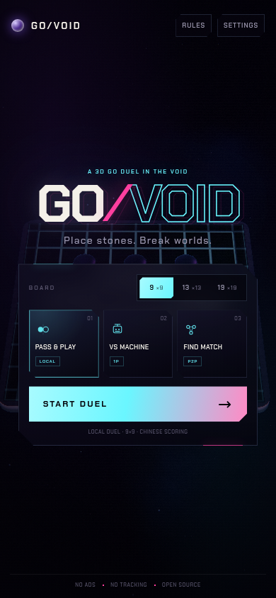
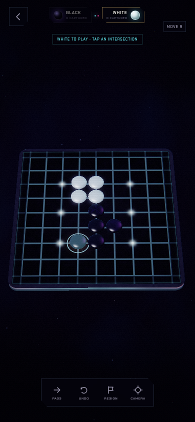

# GO/VOID

A mobile-first 3D Go duel in a neon void. Place stones, break worlds.

**Play it live:** <https://boogercheeseonrye.github.io/go-void/>

- **Pass & Play** — two players, one phone.
- **VS Machine** — a tactical AI in a Web Worker, four difficulty levels.
- **Find Match** — peer-to-peer quick match with a server relay fallback (requires the relay server; see [GitHub Pages](#github-pages)).
- **Real 3D board** — a hand-written WebGL2 renderer: instanced stones, soft shadows, bloom, particles, impact frames and a procedural soundtrack. No Three.js, no game framework, no runtime UI library.
- **Installable PWA** — the shell and all assets are cached, so local and AI duels work offline. The manifest rotates freely between portrait and landscape, with a compact two-column menu and full-bleed board on short landscape screens.
- **Portable static build** — relative URLs and a versioned service worker let the same files deploy to GitHub Pages, a subpath or a custom domain.




## Run it

Requires **Node.js 20.11+** (Node 22/24 recommended) and a browser with WebGL2, ES modules, WebRTC and service workers.

```bash
npm install
npm start
```

Open <http://localhost:4173>. For a phone on the same Wi-Fi, open `http://<your-lan-ip>:4173`.

```bash
npm run dev      # restart the server on file changes
npm run icons    # regenerate PWA icons from public/icons/icon.svg
```

### Configuration

| Variable | Default | Purpose |
| --- | --- | --- |
| `PORT` | `4173` | HTTP and WebSocket port. |
| `HOST` | `0.0.0.0` | Listen address. |
| `ALLOWED_ORIGINS` | — | Comma-separated production origins, e.g. `https://go.example`. When set, only those origins are accepted for WebSockets; include every public hostname you serve. |
| `ICE_SERVERS` | Google + Cloudflare STUN | JSON array of WebRTC ICE servers. Add a TURN server for strict NATs. |

```bash
PORT=8080 ALLOWED_ORIGINS=https://go.example npm start
```

Put the app behind TLS in production (`wss://`). The server is dependency-light (`ws` only) and keeps all match state in memory.

## GitHub Pages

The repository includes a Pages workflow that publishes `public/` on every push to `main`. All asset URLs are relative, so the site works at a project subpath as well as at a custom domain. In **Settings → Pages**, the source must be set to **GitHub Actions** (already configured for this repository).

The live site is <https://boogercheeseonrye.github.io/go-void/>.

GitHub Pages is static: it can host local and AI duels, the PWA and the full interface, but it cannot run WebSockets. The online card shows **NO RELAY** until a matchmaking server is configured, and local/AI play remains fully available.

To enable online duels on Pages:

1. Deploy the relay from this repository over HTTPS (Docker example below), with the Pages origin allowed:
   ```bash
   docker build -t go-void .
   docker run --rm -p 4173:4173 \
     -e ALLOWED_ORIGINS=https://<owner>.github.io \
     go-void
   ```
   Put it behind a TLS reverse proxy so the public endpoint is `wss://relay.example/ws`.
2. In the GitHub repository, open **Settings → Secrets and variables → Actions → Variables**, create `GO_VOID_RELAY_URL` with the exact `wss://relay.example/ws` URL, then re-run **Deploy GitHub Pages**.
3. Add every Pages origin you use to `ALLOWED_ORIGINS`; comma-separate multiple origins.

The workflow writes `public/config.js` with the configured URL and disables same-origin relay probing. Without the variable it generates an empty relay URL, which is why the Pages build degrades cleanly to local/AI play.

`config.js` is also the runtime switch for any static host:

```js
window.GO_VOID_CONFIG = Object.freeze({
  relayUrl: 'wss://relay.example/ws',
  sameOriginRelay: false,
});
```

Set `sameOriginRelay: true` only when the page and the relay share an origin, as they do under `npm start`.

### Docker

The included `Dockerfile` runs the combined static site and matchmaking relay as an unprivileged Node process:

```bash
docker build -t go-void .
docker run --rm -p 4173:4173 -e ALLOWED_ORIGINS=https://<owner>.github.io go-void
```

## Controls

| Action | Touch | Mouse / keyboard |
| --- | --- | --- |
| Place a stone | Tap an intersection | Click |
| Orbit the camera | Drag | Drag |
| Zoom | Pinch | Scroll wheel |
| Recenter | **CAMERA** button | `R` |
| Pass | **PASS** | `P` |
| Undo | **UNDO** | `U` |
| Leave the duel | Back arrow | `M` / `Esc` |
| Dismiss a modal | Close / backdrop | `Esc` |

During scoring, tap groups to toggle dead stones, then press **SCORE**.

## Rules

- Chinese area scoring: stones on the board plus surrounded empty territory; White receives komi.
- Komi is 6.5 on 9×9, 7.5 on 13×13 and 19×19.
- Suicide is illegal unless the move captures.
- Simple ko and positional superko are enforced.
- Two consecutive passes enter scoring. Dead stones can be marked before the final score.
- In an online duel both players mark dead groups and press **SCORE**; only groups both marked are removed, so the result is identical on both screens.
- Undo, resign, replay, and rematch are supported. Online undo is disabled to avoid desync.

## How it works

```
public/
  index.html              menu, HUD, modals and templates
  app.css                 responsive neon UI
  js/core/go.js           rules engine: captures, ko, superko, scoring, replay
  js/core/ai.js           tactical evaluation, search and opening book
  js/workers/ai-worker.js AI off the main thread
  js/render/              WebGL2 renderer, shaders, orbit camera, math
  js/net.js               WebSocket signalling, WebRTC, relay fallback
  js/main.js              menu flow, touch input, HUD, scoring and match state
  js/audio.js             procedural WebAudio soundscape and haptics
  js/impact.js            capture/atari/win/lose impact frames
  config.js               optional static-host relay configuration
  sw.js                   versioned, scope-relative offline cache
server/
  server.mjs              HTTP + WebSocket entry point
  matchmaking.mjs         queues, rooms, relay, heartbeat and rate limits
  security.mjs            headers, origin policy, validation primitives
  static.mjs              safe static file serving
```

### Rendering

`fframes` is a video-rendering framework, not a real-time browser game engine, so it is not used here. Instead, the board is drawn with a custom WebGL2 pipeline: a procedural nebula, an extruded slab with bevel lighting, an instanced stone mesh with per-stone translation, soft blob shadows, grid lines, territory markers, sparks, a bloom chain and a composite pass. Camera fit is aspect-aware for portrait phones, tablets and desktop.

Quality auto-scales resolution and effects; **Settings → Render Quality** can force high or low. Reduced motion disables impact frames and cuts ambient animation.

### Matchmaking and P2P

1. Both clients connect to the configured relay (same-origin `/ws` under `npm start`) and join a queue for the chosen board size.
2. The server pairs them, assigns colors and an initiator, and passes WebRTC offers/answers/ICE candidates.
3. An ordered DataChannel carries moves, passes, resignations and rematch offers.
4. If ICE fails or takes longer than 5.2 seconds, the same validated messages flow through the WebSocket relay. Add `?relay=1` to force relay mode.

The server never sees P2P game messages during a direct match. It sees only signalling and, in relay mode, move payloads. It stores nothing after a room closes.

### AI

The bot runs in a module worker with input validation and a main-thread fallback. It evaluates liberties, captures, ataris, eyes, influence, and opponent threats, then searches with alpha-beta pruning. Difficulty changes search depth, candidate breadth and randomness. It opens in the center on 9×9.

## Testing

```bash
npm test            # rules, AI, security primitives and HTTP/WS integration
npm run test:core   # rules + AI only
npm run test:e2e    # Playwright end-to-end, needs a display
```

The end-to-end suite requires headed Chromium because the headless shell in this environment has no WebGL2. On Linux:

```bash
E2E=1 xvfb-run -a -s '-screen 0 1280x1024x24' node --test tests/e2e.test.mjs
```

`npm run test:e2e` does this for you. It covers menu boot, local play, scoring, result/rematch, settings persistence, AI replies and undo, relay matchmaking, move sync, resignation, rematch, online score consensus, static subpath hosting with relative assets, and offline PWA startup.

`npm audit --omit=dev` reports no known vulnerabilities in the production dependency tree.

## Security

See [SECURITY.md](SECURITY.md) for the threat model, headers, validation, and reporting instructions. In short: strict CSP, same-origin WebSocket policy, per-IP limits, token-bucket rate limiting, size-capped validated messages, sanitized display names and no user HTML. GitHub Pages cannot send custom HTTP headers, so the static build also ships a restrictive CSP and referrer policy in `index.html`; use the Node/container deployment when you need the full header set.

## Notes

- The game needs WebGL2. On unsupported devices the loading screen explains the requirement rather than showing a broken board.
- WebRTC exposes each peer's IP to the other peer, as with any direct P2P game. Use `?relay=1` or disable WebRTC if that matters.
- GitHub Pages cannot host the WebSocket relay. Online play on Pages requires a separately hosted relay and the `GO_VOID_RELAY_URL` Actions variable; without it the online card is shown as **NO RELAY**.
- Fonts are Chakra Petch and Space Grotesk, licensed under the SIL Open Font License (see `public/fonts/`).
- The code is MIT licensed.
